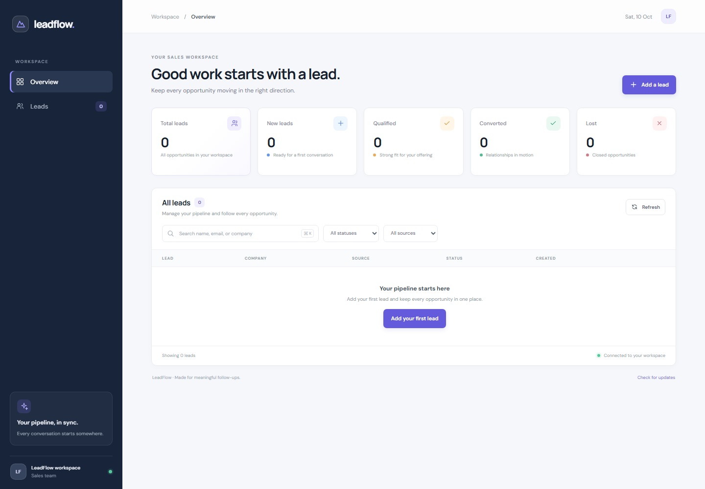

# LeadFlow — AI CRM Automation

LeadFlow is a small, full-stack CRM for capturing prospects and managing a sales pipeline. It uses a responsive HTML/CSS/vanilla JavaScript dashboard, a Node.js and Express REST API, MongoDB through Mongoose, and an optional n8n webhook for new-lead events.

> The optional n8n workflow validates the event and records it in n8n execution history. It does not send email or write to Google Sheets. No authentication is implemented; use synthetic data for demos and keep this development app on a trusted local network.

## Features

- Create, list, view, edit, and delete leads.
- Search by name, email, or company; filter by status and source.
- Track `New`, `Contacted`, `Qualified`, `Converted`, and `Lost` statuses.
- View total, new, qualified, converted, and lost dashboard counts.
- Validate server input, normalize email addresses, reject duplicate emails, and track timestamps.
- Receive clear loading, empty, success, and error states in the dashboard.
- Optionally notify an n8n webhook after a lead is saved. A webhook failure does not discard the lead.
- Run API and workflow validation tests using Node.js's built-in test runner.

## Technology

- Frontend: HTML5, CSS3, vanilla JavaScript
- Backend: Node.js 24+, Express 5, CommonJS
- Database: MongoDB and Mongoose
- Automation: n8n webhook workflow export
- Configuration: dotenv
- Tests: `node:test` and `node:assert`

## Architecture

```text
Browser
  ├── GET /                 → public/index.html
  ├── GET /css/*, /js/*     → public assets
  └── /api/leads            → Express routes → Mongoose → MongoDB (leadflow)
                                └── optional POST → n8n webhook
```

| Path | Purpose |
| --- | --- |
| `server.js` | Loads environment variables, connects to MongoDB, starts Express |
| `app.js` | Configures health endpoint, JSON parsing, API routes, static assets, and errors |
| `config/db.js` | MongoDB connection |
| `models/Lead.js` | Lead schema, constraints, status enum, timestamps |
| `routes/leadRoutes.js` | Lead CRUD, search, filters, request validation |
| `middleware/errorHandler.js` | Consistent JSON error responses |
| `public/` | Dashboard HTML, CSS, and browser JavaScript |
| `automation/` | Optional n8n notifier, importable workflow, setup guide |
| `tests/api.test.js` | Live MongoDB-backed API tests and workflow validator tests |

## Requirements

- Windows 10/11, macOS, or Linux
- Node.js 24 or another recent Node.js release with built-in `fetch` and `node:test`
- npm
- MongoDB running locally, or access to a MongoDB deployment you control
- n8n is optional

## Installation

In PowerShell, from the repository root:

```powershell
Set-Location -LiteralPath 'C:\Users\SMIT\internship-projects\task-1-leadflow'
npm install
Copy-Item .env.example .env
```

If `.env` already exists, do not overwrite it with `Copy-Item`; edit the existing file instead. Set `MONGODB_URI` to the MongoDB database you want to use. The example points to the local `leadflow` database:

```dotenv
PORT=3000
MONGODB_URI=mongodb://127.0.0.1:27017/leadflow
N8N_WEBHOOK_URL=
```

Keep `.env` private. It is ignored by Git. `.env.example` contains placeholders/default local values only.

Start the server:

```powershell
npm start
```

Open <http://127.0.0.1:3000> in a browser. Confirm the server is healthy:

```powershell
curl.exe --fail-with-body --silent --show-error http://127.0.0.1:3000/api/health
```

Expected response with MongoDB connected:

```json
{"success":true,"data":{"status":"ok","database":"connected"}}
```

For development with automatic restart on source changes:

```powershell
npm run dev
```

Stop the server with `Ctrl+C`.

## Using the dashboard

1. Choose **Add a lead**, complete the required fields, and save.
2. Use the search box to find leads by name, email, or company.
3. Filter by a pipeline status or a source.
4. Use the row edit action to change lead details or status.
5. Use the row delete action and confirm to remove a lead.

Status changes and lead edits are saved in MongoDB. Dashboard counts and list rows are loaded from the API.

## REST API

Base path: `/api`

| Method | Endpoint | Behavior |
| --- | --- | --- |
| `GET` | `/api/health` | Returns application and MongoDB connection status |
| `POST` | `/api/leads` | Creates a lead; returns `201` |
| `GET` | `/api/leads` | Lists leads; accepts optional `search`, `status`, and `source` query parameters |
| `GET` | `/api/leads/:id` | Retrieves a lead by MongoDB ObjectId |
| `PATCH` | `/api/leads/:id` | Updates one or more supplied lead fields |
| `DELETE` | `/api/leads/:id` | Deletes a lead |

### Lead fields

Required on creation: `name`, `email`, `phone`, `company`, `source`, and `enquiry`. `status` defaults to `New`.

```json
{
  "name": "Alex Example",
  "email": "alex@example.test",
  "phone": "+1 555 0100",
  "company": "Example Co",
  "source": "Website",
  "enquiry": "Interested in a product demo.",
  "status": "New"
}
```

Emails are trimmed, lowercased, and unique. Status must be one of `New`, `Contacted`, `Qualified`, `Converted`, or `Lost`. Records include Mongoose `createdAt` and `updatedAt` timestamps.

Example PowerShell request:

```powershell
$body = @{
    name = 'Alex Example'
    email = 'alex@example.test'
    phone = '+1 555 0100'
    company = 'Example Co'
    source = 'Website'
    enquiry = 'Interested in a product demo.'
} | ConvertTo-Json -Compress

curl.exe --include --request POST `
  --header 'Content-Type: application/json' `
  --data-raw $body `
  http://127.0.0.1:3000/api/leads
```

List filters can be combined:

```text
GET /api/leads?search=alex&status=New&source=Website
```

Successful responses use `success: true` and a `data` property. Errors use `success: false` and an `error.message`; validation errors may also include `error.details`.

| Status | Meaning |
| --- | --- |
| `200` | Read, update, or delete succeeded |
| `201` | Lead created |
| `400` | Invalid JSON, lead fields, filters, or ObjectId |
| `404` | Route or lead not found |
| `409` | Duplicate email address |
| `500` | Unexpected server error |
| `503` | Health endpoint reports MongoDB disconnected |

## n8n automation (optional)

The workflow export is [`automation/lead-created-workflow.json`](./automation/lead-created-workflow.json). Import it into n8n, save and publish it, and set `N8N_WEBHOOK_URL` in the local `.env` to the workflow's **Production URL**. Restart LeadFlow after changing `.env`, then create a new lead and inspect n8n's **Executions**.

LeadFlow first persists the lead in MongoDB, then posts a `lead.created` payload to n8n. The webhook timeout is three seconds. If n8n is unavailable or returns an error, LeadFlow logs a safe failure message and still returns the created lead successfully; it does not retry the webhook.

For detailed import steps, payload shape, and limitations, see [`automation/README.md`](./automation/README.md). The cloud workflow was manually verified with a synthetic lead; external email or spreadsheet integrations are not configured.

## Testing and quality checks

MongoDB must be running, and `.env` must contain a valid `MONGODB_URI`. Tests use clearly marked synthetic records and remove them afterward:

```powershell
npm test
npm audit
```

The suite verifies CRUD operations, filtering, validation errors, duplicate handling, webhook success/failure behavior, and n8n workflow validation. Expected: all tests pass and `npm audit` reports no vulnerabilities.

## Screenshots

The following dashboard screenshot shows the empty state with synthetic data:



The screenshot was captured with the lead API replaced by an empty synthetic response. When creating additional screenshots, use synthetic demo data only; do not capture real names, emails, phone numbers, or customer enquiries. The running app can display real MongoDB data, so check the screen before taking or sharing screenshots.

## Security and data handling

- There is no authentication or authorization. Do not expose this development app directly to the public internet.
- Do not commit `.env`, webhook URLs that contain credentials, API keys, passwords, or real lead data.
- Request JSON is limited to 10 KB; server and schema validation constrain accepted input.
- Search terms are escaped before being used in MongoDB regular expressions.
- This project does not add a rate limiter; use only in a trusted local/dev environment.
- MongoDB connection logging does not print the connection URI.
- The n8n workflow stores the validated lead in execution data according to the n8n instance's retention settings. Consider your privacy obligations before sending personal data to an external n8n service.

## GitHub preparation

The intended repository name is `internship-projects`; LeadFlow lives in `task-1-leadflow/`. Local milestone commits are present, but no remote is configured and nothing has been pushed. Review `git status` and inspect staged files before choosing to create a GitHub repository or publish this project.
